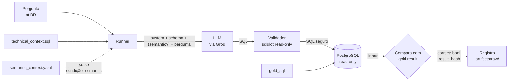

# Arquitetura do agente e do contexto

Este documento responde a três perguntas de arquitetura que surgem quando se tenta entender o `semantic_context.yaml` como artefato e o experimento como sistema. Complementa `docs/briefing.md` com a mecânica de execução.

## Fluxo de uma pergunta



Versão ASCII caso o Mermaid não renderize:

```
Pergunta ──┐
           ├──► Runner ──► Prompt único ──► LLM ──► SQL ──► Validator ──► Postgres ──► Compare ──► Record
Técnica ───┤                                                                              ▲
Semântica ─┘                                                                              │
                                                                            gold_sql ─────┘
```

Nenhuma seta de retroalimentação do LLM pra fontes externas. **Nenhum retrieval, nenhuma ferramenta, nenhuma busca vetorial, nenhum encadeamento de chamadas.** Uma chamada de LLM por tentativa; até 3 tentativas por pergunta/condição se houver falha de validação ou execução, sempre com feedback técnico (não semântico) do erro.

## As seções do YAML são tabelas?

Não. O `semantic_context.yaml` é um arquivo de texto. As seções (`money_fields`, `count_fields`, `grain_rules`, `temporal_rules`, `referential_rules`, `synonyms`, `response_style`) são **chaves de um dicionário em disco**, não objetos de banco.

Em `src/tccsql/experiment/runner.py:13`:

```python
technical = (d/"technical_context.sql").read_text()
semantic  = technical + "\n\nSEMÂNTICA:\n" + (d/"semantic_context.yaml").read_text()
```

Esse é o único ponto do pipeline em que o YAML é lido. O conteúdo inteiro, como string literal, vira parte da mensagem de usuário enviada ao LLM. O YAML nunca é parseado, indexado ou consultado seletivamente — ele é um blob de texto no prompt.

## O agente percorre uma sequência?

Não. Em `src/tccsql/agent/text2sql.py:13-19`:

```python
def attempt(self, question, context, feedback=None):
    prompt = f"ESQUEMA:\n{context}\n\nPERGUNTA:\n{question}\nSQL:"
    messages = [Message("system", SYSTEM), Message("user", prompt)]
    if feedback:
        messages.append(Message("user", f"A tentativa anterior falhou tecnicamente: {feedback}. Corrija e responda somente SQL."))
    response = self.provider.generate(messages, self.model_config)
    candidate = extract_sql(response.text)
```

Uma chamada HTTP ao `/chat/completions` do Groq por tentativa. Mensagens enviadas:

1. `system`: "Você é um agente text-to-SQL PostgreSQL. Responda somente com uma única consulta SELECT ou WITH terminada em SELECT. Não explique."
2. `user`: `ESQUEMA:\n<technical + semantic>\n\nPERGUNTA:\n<pergunta>\nSQL:`
3. (em retentativa) `user`: `A tentativa anterior falhou tecnicamente: <erro>. Corrija e responda somente SQL.`

O LLM responde com SQL. O sqlglot valida se é SELECT/WITH read-only (`src/tccsql/database/safety.py`). Se válido, o Postgres executa. Se executar sem erro e o hash do resultado baterem com o gold (com as relaxações de D-005), `correct = true`.

Não há cadeia de prompts. Não há planejamento. Não há execução iterativa de sub-queries. É uma transformação `pergunta → SQL` em uma rodada.

## O que garante o uso das informações do contexto semântico?

**Nada estrutural.** A garantia é a atenção do transformer sobre o contexto da mensagem. O `semantic_context.yaml` inteiro cabe na janela do modelo (~2.9KB; `gpt-oss-120b` e `qwen3.8-27b` têm janelas de dezenas de milhares de tokens); a cada token gerado, o mecanismo de atenção pondera todos os tokens de entrada e escolhe o que é relevante. O conteúdo da seção `grain_rules` não é "chamado" — ele compete pela atenção do modelo com o resto do prompt.

Isso tem três consequências que o TCC precisa explicitar:

1. **O contexto semântico é prompt engineering, não arquitetura de dados.** Não é uma camada de abstração sobre o Postgres, é um bloco de texto dirigido ao LLM.
2. **Instruções ambíguas ou genéricas vazam.** Na primeira versão do YAML, `valor_pedido: orders.total_amount` foi interpretado pelo modelo como "sempre use total_amount para qualquer menção a valor de pedido" — por isso Q008 (pedia `gross_amount`) falhou na semântica e passou na técnica. A solução em D-005 foi listar cada campo monetário por nome, eliminando o synonym único.
3. **O ganho é estatístico, não garantido.** Mesmo com o YAML cuidadosamente escrito, o modelo ainda erra em perguntas em que o contexto não cobre a ambiguidade (Q019 "quantidade de itens" = COUNT ou SUM?, Q040 "diferença somada por pedido" = agregada ou por linha?). O experimento mediu o ganho médio, não garantiu correção caso a caso.

## Implicação para a tese

A camada semântica não é uma nova camada de dados além de bronze/silver/gold. É um **artefato textual separado do dado**, dirigido ao consumidor LLM, que convive com (e depende de) um schema físico bem modelado. O que a tese defende: um agente LLM só atinge correctness alta quando o schema técnico é acompanhado desse artefato semântico explícito — mas o artefato opera como instrução de prompt, não como estrutura queryable.

Isso diferencia o experimento de arquiteturas como a "semantic layer" do Cube/LookML/dbt, que também servem agentes mas via API ou DSL — portanto queryable. Aqui, estuda-se o caso mais simples e mais comum: o agente recebe texto, decide por atenção, gera SQL. É o pior caso em termos de garantia — e mesmo nesse pior caso o efeito é mensurável e significativo.
